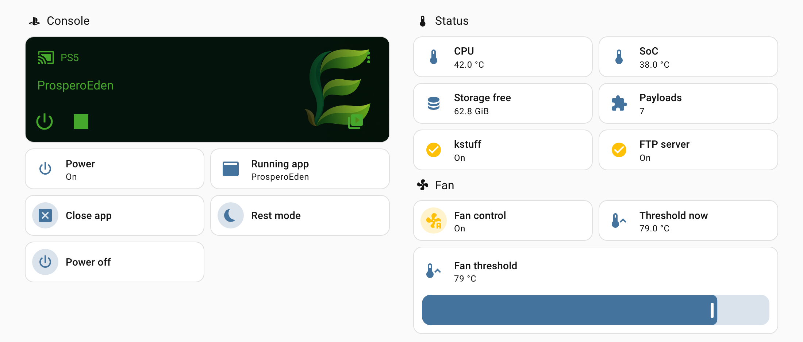
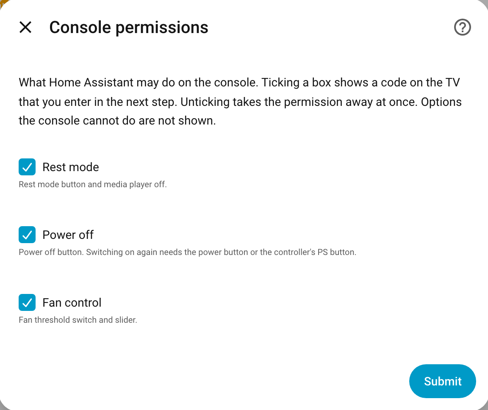

# PS5 (ps5-hass) for Home Assistant

Brings a jailbroken PS5 into Home Assistant: what is running (with cover), all installed games and apps in the media
browser and as sources, start/switch/close apps, temperatures and free storage, running payloads, messages on the TV,
app started/stopped events and, if you allow it, rest mode, power off and the fan threshold. No YAML, no MQTT broker,
no PSN account, no cloud.

It talks to the [ps5-hass payload](https://github.com/Phynix88/ps5-hass-payload) running on the console and to
Sony's own status query (to tell "rest mode" from "off").



## Requirements

- A PS5 with a jailbreak and the **ps5-hass payload** loaded (see the payload's README; it can be installed through
  the Payload Manager and put into the autoload). Payload **v0.3.0 or later** (current: v0.3.1) for everything below; with v0.2.0
  permissions have to be set in `config.json` over FTP, with v0.1.0 messages, payloads, power off and the fan are
  missing as well.
- Home Assistant 2026.10 or later, in the same local network.
- Home Assistant must reach the console on **TCP 8181** (payload) and **UDP 9302** (Sony's status query; without it
  rest mode shows as `off`). Automatic discovery needs mDNS: Home Assistant in Docker needs host networking, and the
  console must be in the same subnet.
- Give the console a fixed IP address (DHCP reservation in your router).

## Installation

**HACS:** HACS → ⋮ → **Custom repositories** → add `https://github.com/Phynix88/ps5-hass` with type
*Integration* → search **PS5 (ps5-hass)** → **Download** → restart Home Assistant. Updates then show up in
HACS and as an update entity.

**Manually:** copy `custom_components/ps5_hass/` to `<config>/custom_components/ps5_hass/` and restart. To update,
replace the folder and restart again.

## Setup

1. Load the payload on the PS5. Home Assistant shows **"PS5 found"** (mDNS). Otherwise add the integration
   **PS5 (ps5-hass)** and enter the console's IP address (port 8181) or its `.local` name. Other host names must
   first be added to `"hosts"` in the payload's `config.json`, or Home Assistant reports "Cannot reach the payload".
2. The console shows `ps5-hass pairing code: 123456` on the TV. Enter the 6 digits within two minutes.
   **Missed it or too slow?** Tick **"Show a new code"** and press *Submit*; the TV shows a fresh code (at most one
   every 30 s). Closing the dialog and starting again works too.

If the console forgets the pairing (for example after its `config.json` was deleted), Home Assistant asks you to
pair again. Removing the integration gives the pairing slot back to the console (only while the console is on and
the payload runs; otherwise the slot stays used until the pairings are reset on the console).

If the console gets a new IP address, add the integration again with the new address: Home Assistant updates the
existing entry and reports "already set up".

## What you get

| Entity | Notes |
|---|---|
| `media_player.ps5` | `playing` (app running), `idle` (home screen), `on` (console on, payload not loaded), `off` (rest mode or off; `sensor.ps5_power` tells them apart). Source list = installed titles, games first; selecting a source starts it (a running app is closed first). Stop closes the running app. Turn off = rest mode, only when allowed. Cover of the running app as picture. Media browser, see below. |
| `notify.ps5` | message on the TV, see below |
| `sensor.ps5_cpu_temperature`, `sensor.ps5_soc_temperature` | °C |
| `sensor.ps5_storage_free` | GiB free on the internal SSD |
| `sensor.ps5_running_app` | name, attributes `title_id`, `kind` |
| `sensor.ps5_power` | `on`, `standby`, `off` |
| `sensor.ps5_payloads` | number of running payloads, attribute `names` |
| `binary_sensor.ps5_jailbreak_kstuff`, `binary_sensor.ps5_shadowmount`, `binary_sensor.ps5_ftp_server`, `binary_sensor.ps5_websrv` | whether that payload runs (`kstuff.elf`, `shadowmountplus.elf`, `ftpsrv.elf`, `websrv.elf`; diagnostic) |
| `sensor.ps5_uptime`, `sensor.ps5_fan_raw` | diagnostic, disabled by default (the fan value is the raw console value) |
| `image.ps5_cover` | cover of the running app |
| `event.ps5_app` | `started` / `stopped` with `title_id`, `name`, `kind`. No event when the console goes to rest mode or off; if the app is gone afterwards, `stopped` fires when the payload is back. Use `sensor.ps5_power` for power changes. |
| `button.ps5_close_app` | closes the app that Home Assistant shows as running |
| `button.ps5_rest_mode` | only when rest mode is allowed on the console |
| `button.ps5_power_off` | only when power off is allowed on the console |
| `switch.ps5_fan_control`, `number.ps5_fan_threshold` | only when fan control is allowed on the console, see below |
| `sensor.ps5_fan_threshold_current` | threshold the console uses right now (diagnostic) |
| `button.ps5_start_<app>` | one per favourite (options) |

Entity IDs follow your Home Assistant language (for example `sensor.ps5_cpu_temperatur` in German).

### Options

Settings → Devices & services → PS5 → **Configure** opens a menu:

- **Sources and favourites:** source list (all apps and games, or games only) and favourite apps (each gets its own
  start button).
- **Console permissions:** rest mode, power off and fan control, see below.

## Media browser

**Media → PS5** shows the folders *Games* and *Apps* with covers. Clicking a title starts it on the console (a
running app is closed first). The same works from a media card on a dashboard. While the console is off the browser
is empty.

Starting a title from an automation: `media_player.select_source` with the title's name, or `media_player.play_media`
with its title id.

```yaml
action: media_player.play_media
target:
  entity_id: media_player.ps5
data:
  media_content_type: app
  media_content_id: PPSA01234
```

## Messages on the TV

`notify.ps5` shows a message as a notification on the TV. A title is put in front
of the message (`title: message`). At most 200 bytes (longer texts are cut), 5 messages per 30 seconds.

```yaml
action: notify.send_message
target:
  entity_id: notify.ps5
data:
  title: Door
  message: Someone is at the front door
```

## Rest mode, power off and the fan

The console refuses these until you allow them. Allowing is bound to the console: you need the code it shows on the
TV.

1. Options → **Console permissions**, tick what Home Assistant may do, *Submit*.
2. The TV shows `ps5-hass: "Home Assistant" asks to allow power off. Code: 123456`. Enter the code (missed it? tick
   **Show a new code**).
3. The entities appear at once.

Unticking takes a permission away at once, without a code; its entities become unavailable (delete them if you do
not want to see them). Options that the console cannot do are not shown.



| Permission | Allows |
|---|---|
| Rest mode | `button.ps5_rest_mode`, media player turn off |
| Power off | `button.ps5_power_off`. Switching on again needs the power button or the controller's PS button. |
| Fan control | fan threshold (switch, slider, current value) |

Without the options (or with payload v0.2.0): set `"power_actions"`, `"power_off"` or `"fan_control"` to `true` in
`/data/ps5-hass/config.json` on the console and restart the payload.

**Fan threshold:** the temperature at which the console speeds up its fan. Lower = cooler and louder.

- `switch.ps5_fan_control` on: the console uses `number.ps5_fan_threshold` (45–85 °C, never above the console's
  factory value, 91 °C on FW 13.60). Switching on again uses the last threshold (80 °C the first time). Setting
  `number.ps5_fan_threshold` also switches fan control on.
- Off: the console's factory value again.
- `sensor.ps5_fan_threshold_current` is what the console uses right now.
- The payload sets the value again if the console resets it. If another tool changes the fan, the payload leaves
  it alone and reports it (`/api/v1/info`, `last_error`); setting a threshold in Home Assistant again takes over
  again.

Example: cooler while a game runs, factory value again on the home screen.

```yaml
triggers:
  - trigger: state
    entity_id: media_player.ps5
    to: playing
    id: game
  - trigger: state
    entity_id: media_player.ps5
    to: idle
    id: home
actions:
  - choose:
      - conditions: "{{ trigger.id == 'game' }}"
        sequence:
          - action: number.set_value
            target:
              entity_id: number.ps5_fan_threshold
            data:
              value: 75
      - conditions: "{{ trigger.id == 'home' }}"
        sequence:
          - action: switch.turn_off
            target:
              entity_id: switch.ps5_fan_control
```

## Dashboard example

```yaml
type: vertical-stack
cards:
  - type: media-control
    entity: media_player.ps5
  - type: tile
    entity: sensor.ps5_cpu_temperature
  - type: tile
    entity: switch.ps5_fan_control
  - type: tile
    entity: number.ps5_fan_threshold
    features:
      - type: numeric-input
        style: slider
  - type: tile
    entity: button.ps5_rest_mode
    hide_state: true
    tap_action:
      action: perform-action
      perform_action: button.press
      target:
        entity_id: button.ps5_rest_mode
      confirmation:
        text: Put the PS5 into rest mode?
```

To send your own text from a dashboard, create a text helper (`input_text`) and a script that calls
`notify.send_message` with its value.

## How it works

- Every 10 s Home Assistant asks the payload for the state. When it does not answer, the last state is kept for
  30 s (going to rest mode), then Sony's status query decides between `on`, `standby` and `off`.
- The app list is fetched every 10 minutes, and at once when the console reports a change.
- Covers go through Home Assistant's image proxy; only PNG/JPEG up to 1 MB are passed on.

## Security

Plain HTTP in the local network; the token is stored in Home Assistant's config entry (removed from diagnostics).
Permissions for rest mode, power off and the fan need a code from the TV. See the payload README, *Security and
limits*.

## Limits

- Waking the console from rest mode or power off is not possible (it needs Remote Play pairing with a PSN login).
- No controller input, no screenshots, no controller battery (the console refuses pad access from a payload).
- PS4 titles are listed with their title id as name.
- The fan threshold is tested on FW 13.60 (CFI-2116) only.

## Troubleshooting

- **Not found automatically:** add it by IP address; check that the payload runs (`http://<ps5>:8181/api/v1/info`).
  mDNS does not cross subnets.
- **"Cannot reach the payload" with a host name:** use the IP address or the `.local` name, or add the name to
  `"hosts"` in the payload's `config.json`.
- **Media player says `on`, everything else is unavailable:** the payload is not running. After every console restart
  run the jailbreak again; the Payload Manager's autoload then starts ps5-hass.
- **Rest mode shows as `off`:** UDP 9302 to the console is blocked, or "Stay connected to the internet" is off in the
  console's power saving settings (then the console leaves the network in rest mode).
- **Pairing locked:** after 10 wrong codes in a row the console locks pairing for 15 minutes (growing); wait, or
  restart the payload.
- **Power off / fan entities missing:** allow them in the options → Console permissions (see above).
- **"Granting is locked":** 10 wrong codes in a row lock granting for 15 minutes; wait, or restart the payload.
- **Report a problem:** download the diagnostics (Settings → Devices → PS5 → ⋮ → Download diagnostics; the token is
  removed) and add the payload's `/api/v1/info`.

## Removal

1. Turn `switch.ps5_fan_control` off if you used it (the console gets its factory threshold back).
2. While the console is on and the payload runs: Settings → Devices & services → PS5 → ⋮ → **Delete**. This frees
   the pairing slot on the console.
3. HACS → PS5 (ps5-hass) → ⋮ → **Remove** (or delete `custom_components/ps5_hass/`), then restart Home Assistant.

## Development

```sh
python3.14 -m venv .venv && .venv/bin/pip install -r requirements_test.txt
.venv/bin/python -m pytest -q
```

Tests run against a stateful fake of the payload whose answers are checked against the payload's JSON schema
(`tests/fixtures/schema.json`).

## License

GPL-3.0-or-later.
